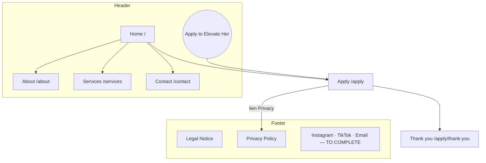

# Stratégie du site — Elevate Her

*Étape 1 sur 7 · 24 octobre 2026 · à valider par Ethan avant l'étape Textes*

Ce document propose l'arborescence finale, le contenu de chaque section et les champs du formulaire de candidature. Les intitulés en anglais sont des titres de travail : les textes définitifs seront rédigés à l'étape 2.

Fils conducteurs :
- **Un seul objectif** : faire candidater des créatrices ambitieuses. Le bouton **Apply to Elevate Her** est présent dans le header, en fin de chaque page et dans le menu mobile.
- **La sélectivité se ressent partout** : « By application only », « Limited roster », un processus de sélection en étapes, un formulaire qui donne l'impression d'entrer dans un cercle choisi.
- **Le parcours signature** Brand → Audience → Growth → Revenue → Opportunities structure la page d'accueil, la page Services et le découpage des services officiels.
- **La créatrice est le sujet, l'équipe reste en coulisses** : chaque page est écrite de son point de vue.

---

## 1. Arborescence

Site plat, 1 niveau : toute page importante est à 1 clic de l'accueil.

```
Home (/)
├── About (/about)                     « The team behind her »
├── Services (/services)               le parcours en 5 étapes, la protection, la façon de travailler
├── Apply (/apply)                     processus de sélection, formulaire, FAQ
│   └── Thank you (/apply/thank-you)   confirmation après envoi (noindex)
├── Contact (/contact)
├── Legal Notice (/legal-notice)
├── Privacy Policy (/privacy-policy)
└── 404 (/404)
```



| Page | URL | Rôle | Dans le menu | Priorité |
|---|---|---|---|---|
| Home | `/` | Raconter toute l'histoire en un long scroll et amener à la candidature | Logo | Haute |
| About | `/about` | L'équipe derrière elle, le sens de « Her » et de « Private Club » | Header | Haute |
| Services | `/services` | Le parcours en 5 étapes, le détail des services, la protection | Header | Haute |
| Apply | `/apply` | Processus de sélection, formulaire, FAQ | Bouton CTA | Très haute |
| Thank you | `/apply/thank-you` | Confirmation et suite du processus | Aucun (noindex) | Moyenne |
| Contact | `/contact` | Marques, presse, questions. Redirige les créatrices vers Apply | Header | Moyenne |
| Legal Notice | `/legal-notice` | Mentions légales | Footer | Basse |
| Privacy Policy | `/privacy-policy` | Politique de confidentialité, liée depuis le formulaire | Footer | Basse |
| 404 | `/404` | Page introuvable, renvoie vers Home et Apply | Aucun | Basse |

Règles d'URL : minuscules, tirets, pas de barre finale, une seule version canonique par page.

Pas de fil d'Ariane visible : avec un seul niveau, il n'apporterait rien. Les données structurées restent limitées à Organization et WebSite.

---

## 2. Navigation

**Header** (fixe, se réduit au scroll)
- Gauche : logo `elevate-her-wordmark.svg`, lien vers Home.
- Centre : About · Services · Contact (3 liens, menu court comme chez Main Character).
- Droite : bouton **Apply to Elevate Her**.
- Mobile : logo + bouton **Apply** toujours visible + menu plein écran qui reprend les 3 liens, le bouton et les réseaux.

**Footer** (identique sur toutes les pages)
- Logo wordmark en crème sur fond encre, ou en encre sur rose pâle (à trancher à l'étape Design).
- Une description courte : *The team behind ambitious women building influential brands and valuable businesses.*
- Colonne **Explore** : Home, About, Services, Apply, Contact.
- Colonne **Connect** : Instagram, TikTok, Email `[TO COMPLETE]`.
- Colonne **Legal** : Legal Notice, Privacy Policy.
- Ligne basse : © Elevate Her · *By application only* · ELEVATE ✦ CONNECT ✦ EMPOWER.

**Composant « Apply CTA »** : bloc de fin de page partagé, avec un titre, 3 bénéfices résumés (A dedicated team · A personalised strategy · Protected growth) et le bouton. Il ferme toutes les pages sauf Apply, où le formulaire tient ce rôle, et Thank you.

---

## 3. Contenu de chaque page

### 3.1 Home `/` — le long scroll

| # | Section | Contenu | Média | Animation prévue |
|---|---|---|---|---|
| 1 | **Hero** | Sur-titre *Creator Growth Agency & Private Club*. Titre *Elevate your brand. Expand your income.* Texte officiel du hero. Bouton **Apply to Elevate Her** + lien discret *Discover the path* qui fait défiler. Mention *By application only · Limited roster*. | Vidéo de fond en boucle `home-hero.mp4` + poster, ou grande image | Titre révélé mot par mot (SplitText), logo qui s'estompe au scroll |
| 2 | **Bandeau défilant** | ELEVATE ✦ CONNECT ✦ EMPOWER ✦ BY APPLICATION ONLY ✦ A DEDICATED TEAM BEHIND AMBITIOUS WOMEN | — | Défilement continu, stoppé si reduced-motion |
| 3 | **Déclaration** | *A dedicated team behind ambitious women.* Puis les 3 temps : *Built for her. Backed by a team. Designed for growth.* Un paragraphe court sur l'équipe qui construit la structure derrière chaque créatrice. | — | Phrases révélées ligne par ligne |
| 3b | **Chiffres clés** `[TO COMPLETE]` | Bandeau de 3 ou 4 chiffres. Masqué par défaut tant qu'Ethan n'a pas fourni les chiffres. | — | Compteurs |
| 4 | **Le parcours (section signature)** | *Brand → Audience → Growth → Revenue → Opportunities.* Section épinglée au scroll : 5 chapitres qui se succèdent, chacun avec un numéro, un titre, une phrase de promesse et les services associés. | 5 images `path-brand`, `path-audience`, `path-growth`, `path-revenue`, `path-opportunities` (portrait 4:5) | Progression au scroll, ligne qui se dessine entre les étapes, images qui glissent |
| 5 | **Ce que chaque créatrice reçoit** | Les 8 services officiels en cartes (3 à 10 de la liste), regroupés par étape du parcours, avec **Protection** (account + content) mise en avant comme bloc à part. Lien vers Services. | — | Apparition en cascade, micro-interaction au survol |
| 6 | **Elle reste le visage** | *She stays the face. The team builds the rest.* Les 2 points « How we work » (a dedicated team, fast communication) + la promesse : *The creator remains the face of her brand. Our team works behind the scenes.* | 1 image paysage `home-behind-the-scenes` (3:2) | Parallaxe légère sur l'image |
| 7 | **Le Private Club** | Fond rose pâle. Citation : *We are not trying to build the biggest roster. We are trying to build the strongest creators.* Les 3 faits : limited roster · by application only · a dedicated team on every account. | Sceau rond décoratif (badge) | Arcs fins qui se dessinent |
| 8 | **Film de marque** `[TO COMPLETE]` | Façade YouTube/Vimeo : poster élégant, lecteur chargé au clic. Masqué tant qu'il n'y a pas de vidéo. | `home-film-poster` (16:9) | — |
| 9 | **Réussites de créatrices** `[TO COMPLETE]` | 3 témoignages ou résultats. Masqué par défaut tant qu'ils n'existent pas, mais prêt. | 3 portraits | Carrousel doux |
| 10 | **Candidater en 4 étapes** | Apply · Review · Conversation · Welcome, chacune en une phrase. Lien vers Apply. | — | Étapes numérotées qui s'allument |
| 11 | **Apply CTA** | Bloc de fin partagé (voir § 2). | — | — |

Les sections 3b, 8 et 9 sont construites, mais masquées par un simple interrupteur dans le fichier de contenu, pour que le site soit crédible dès le lancement sans rien inventer. Ethan les active quand les éléments existent.

### 3.2 About `/about` — « The team behind her »

| # | Section | Contenu |
|---|---|---|
| 1 | Hero | *The team behind her.* Texte : une agence sélective portée par une équipe dédiée, centrée sur la créatrice. |
| 2 | What « Her » means | « Her » désigne **pour qui** l'agence travaille : les créatrices ambitieuses. Formulations autorisées uniquement (*Built for ambitious women.*, *The team behind ambitious female creators.*). |
| 3 | What « Private Club » means | L'approche sélective : un roster volontairement limité, pour que l'équipe reste très impliquée sur chaque compte. Citation « biggest roster / strongest creators ». |
| 4 | How we work | 4 principes issus de la liste officielle : A dedicated team · Fast communication · She remains the face · Protection built in. |
| 5 | The team `[TO COMPLETE]` | Prénoms, rôles, photos, si Ethan veut les montrer. Masqué par défaut. |
| 6 | Apply CTA | Bloc partagé. |

Médias : 1 image hero paysage `about-hero` (3:2), 1 image d'ambiance `about-club` (4:5), portraits éventuels de l'équipe (1:1).

### 3.3 Services `/services` — le parcours en détail

| # | Section | Contenu |
|---|---|---|
| 1 | Hero | *Everything behind her brand.* Une phrase sur la structure complète, pas une prestation isolée. |
| 2 | Le parcours en 5 chapitres | Un chapitre par étape, chacun avec la promesse et les services officiels rattachés : **Brand** (brand development, personalised strategy) · **Audience** (social media management, individual content planning) · **Growth** (stratégie et suivi par l'équipe dédiée) · **Revenue** (revenue management) · **Opportunities** (brand partnership development). Navigation latérale ou sommaire ancré sur desktop. |
| 3 | Protection | Bloc à part, fond rose pâle : account protection + content protection. Argument rassurant que les concurrents mettent peu en avant. |
| 4 | How we work | A dedicated team · Fast communication, expliqués en 2 courts paragraphes. |
| 5 | Is Elevate Her for you? | 3 ou 4 phrases qui décrivent la créatrice visée (ambition, envie de transformer sa marque en entreprise durable), sans critères chiffrés. |
| 6 | Apply CTA | Bloc partagé. |

Médias : 1 image hero `services-hero` (3:2), les 5 images du parcours réutilisées depuis Home.

### 3.4 Apply `/apply` — la candidature

| # | Section | Contenu |
|---|---|---|
| 1 | Hero | *Apply to Elevate Her.* Sous-titre : by application only, limited roster, 5 minutes. Ton : une invitation, pas un guichet. |
| 2 | The selection process | 4 étapes : **Apply** (le formulaire) · **Review** (chaque candidature est lue par l'équipe, délai `[TO COMPLETE]`) · **Conversation** (un échange avec l'équipe) · **Welcome** (équipe dédiée assignée, démarrage). |
| 3 | Le formulaire | Voir § 4. |
| 4 | FAQ | 7 questions, voir § 5. |
| 5 | Fermeture douce | *A question before applying?* → lien Contact. Pas de bloc Apply CTA ici : le formulaire tient ce rôle. |

### 3.5 Thank you `/apply/thank-you`

*Your application has been received.* Rappel des étapes suivantes (Review → Conversation → Welcome), délai `[TO COMPLETE]`, lien vers les réseaux `[TO COMPLETE]` et retour à l'accueil. `noindex`. C'est la page de redirection de Netlify Forms.

### 3.6 Contact `/contact`

| # | Section | Contenu |
|---|---|---|
| 1 | Hero | *Get in touch.* |
| 2 | Deux portes | **Creators** → *The application form is the way in* (lien Apply). **Brands & partners / Press** → email `[TO COMPLETE]`. |
| 3 | Mini-formulaire | Name, Email, Subject (Brand partnership · Press · Other), Message, consentement RGPD. Même mécanique Netlify que la candidature. À confirmer par Ethan. |
| 4 | Coordonnées | Email, Instagram, TikTok, ville ou zone `[TO COMPLETE]`. |
| 5 | Apply CTA | Bloc partagé, version courte. |

### 3.7 Legal Notice, Privacy Policy, 404

- **Legal Notice** : raison sociale, adresse, SIRET, directeur de publication, hébergeur, crédits `[TO COMPLETE]`.
- **Privacy Policy** : quelles données le formulaire collecte, pourquoi, combien de temps, où elles sont stockées (Netlify Forms ou Formspree), droits RGPD, contact `[TO COMPLETE]`. Pas de cookies tant qu'il n'y a pas d'outil de mesure.
- **404** : *This page isn't part of the club.* Retour Home + bouton Apply.

---

## 4. Formulaire de candidature

Objectif : court, élégant, l'impression d'entrer dans un cercle choisi. Un seul `<form>` compatible Netlify Forms, présenté en **3 temps** avec une barre de progression (01 · 02 · 03). Sans JavaScript, les 3 temps s'affichent à la suite : le formulaire reste utilisable.

### 01 · About you
| Champ | Type | Obligatoire |
|---|---|---|
| First name | texte | oui |
| Last name | texte | oui |
| Email | email | oui |
| Where are you based? | texte (ville, pays) | oui |

### 02 · Your presence
| Champ | Type | Obligatoire |
|---|---|---|
| Link to your main profile | URL | oui |
| Main platform | texte libre (ou liste déroulante si Ethan valide les noms de plateformes) | oui |
| What do you create? | texte court (niche, univers) | oui |
| Do you currently earn from your content? | choix : Not yet · Occasionally · Regularly · It's my main income | oui |

### 03 · Your ambition
| Champ | Type | Obligatoire |
|---|---|---|
| Where do you want to be in 12 months? | texte long, 2 à 4 phrases | oui |
| Why Elevate Her? | texte long | non |
| How did you hear about us? | choix : Social media · A creator · Search · Other | non |

### Consentement (avant le bouton)
| Champ | Type | Obligatoire |
|---|---|---|
| I confirm I am 18 or older | case à cocher | oui |
| I agree that Elevate Her stores and processes my information to review my application, as described in the Privacy Policy (lien) | case à cocher | oui |
| Champ anti-spam caché (honeypot) | caché | — |

Bouton : **Submit my application**. Après envoi : redirection vers `/apply/thank-you`.

Choix assumés :
- **Pas de taille d'audience chiffrée** : le lien vers le profil suffit à l'équipe, et ne pas demander de chiffre évite de décourager une créatrice prometteuse. Peut être ajouté si Ethan le souhaite.
- **Pas de téléphone ni de pièce jointe** : l'équipe les demandera lors de l'étape Conversation. Le formulaire reste léger.
- **Aucune plateforme nommée** dans les options tant qu'Ethan ne les a pas validées.
- Total : 10 champs obligatoires, 3 facultatifs. L'étape 6 (form-cro) affinera.

Technique : attributs `data-netlify="true"`, `netlify-honeypot`, champ caché `form-name`, redirection `action="/apply/thank-you"`. Alternative Formspree documentée : remplacer `action` par l'URL Formspree et retirer les attributs Netlify.

---

## 5. FAQ proposée (page Apply)

Questions seulement, réponses rédigées à l'étape 2 :
1. Who can apply?
2. Do I need a certain audience size? (réponse sans chiffre, sauf critère fourni par Ethan)
3. What does « Private Club » mean?
4. What does « Her » mean? (réponse : pour qui l'agence travaille, jamais une affirmation sur la composition de l'équipe)
5. Do I stay in control of my brand and my accounts?
6. What happens after I apply, and how long does it take? `[TO COMPLETE]`
7. Is there a cost? `[TO COMPLETE : modèle économique]` — question retirée si Ethan préfère ne rien dire en ligne.

Données structurées FAQPage ajoutées à l'étape SEO.

---

## 6. Maillage interne

- **Home** est le hub : chaque section renvoie vers sa page détaillée (parcours → Services, Private Club → About, 4 étapes → Apply).
- **About ↔ Services** se renvoient l'une à l'autre (la façon de travailler ↔ le détail des services).
- **Toutes les pages** se terminent par le bloc Apply CTA, sauf Apply et Thank you.
- **Contact** renvoie les créatrices vers Apply et garde l'email pour les marques.
- **Footer** : lien vers chaque page, aucune page orpheline.
- Les ancres des 5 étapes du parcours (`/services#brand`, `#audience`, …) permettent de pointer une étape précise depuis Home.

---

## 7. SEO par page (base pour l'étape 7)

| Page | Title | Meta description (textes officiels) |
|---|---|---|
| Home | Elevate Her — Creator Growth Agency & Private Club for Ambitious Women | A dedicated team helping ambitious women build their brand, audience and income. |
| About | The Team Behind Her — Elevate Her | The team behind ambitious women building influential brands and valuable businesses. |
| Services | Brand, Audience, Growth, Revenue, Opportunities — Elevate Her | Building stronger brands and bigger opportunities for ambitious female creators. |
| Apply | Apply to Elevate Her | A selective creator agency, by application only. Apply to join the private club. |
| Contact | Contact — Elevate Her | Get in touch with the team behind Elevate Her. |

Image de partage générée à partir du badge rond, favicon tiré du badge, sitemap, robots.txt, données Organization.

---

## 8. Emplacements médias prévus (détail à l'étape 5)

| Fichier | Page / section | Type | Ratio |
|---|---|---|---|
| `home-hero.mp4` + `home-hero-poster.webp` | Home / Hero | vidéo de fond | 16:9 desktop, recadrée 9:16 mobile |
| `path-brand`, `path-audience`, `path-growth`, `path-revenue`, `path-opportunities` | Home + Services / parcours | photo | 4:5 |
| `home-behind-the-scenes` | Home / Elle reste le visage | photo | 3:2 |
| `home-film-poster` | Home / film de marque | photo | 16:9 |
| `about-hero`, `services-hero` | hero des pages | photo | 3:2 |
| `about-club` | About / Private Club | photo | 4:5 |
| `team-01` … | About / équipe | photo | 1:1 |

Chaque emplacement affiche un fond rose pâle avec un fin motif ✦ tant que le fichier n'existe pas.

---

## 9. Décisions à prendre par Ethan

1. **Pages et menu** : About · Services · Contact + bouton Apply. OK, ou autres intitulés ?
2. **Champs du formulaire** (§ 4) : ajouts, retraits ? Veux-tu une liste de plateformes dans « Main platform » (il faudra me donner les noms) ou un champ libre ?
3. **Processus de sélection** : les 4 étapes Apply · Review · Conversation · Welcome correspondent-elles à la réalité ? Quel délai de réponse afficher ?
4. **Sections masquées** (chiffres, témoignages, film, équipe) : d'accord pour les construire masquées et les activer plus tard ?
5. **Formulaire de contact** pour les marques et la presse : oui ou simple email ?
6. **FAQ « Is there a cost? »** : on la garde avec une réponse à compléter, ou on la retire ?
